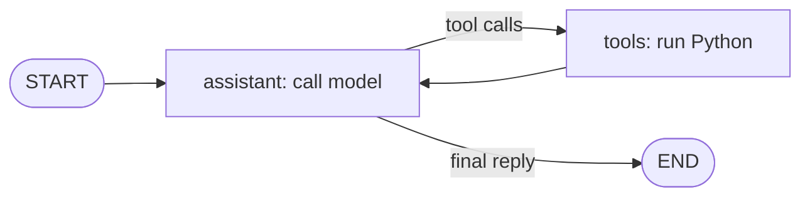

# Day 39: Give our restaurant agent an API and a memory

Today we rebuild **Week 5 → Day 24 → Rag Example → customer_assistant_rag.ipynb**. Students already know Python functions, prompts, tools and retrieval. Teach one new layer at a time: HTTP, FastAPI, LangGraph, then SQLite conversation history.

By the end, a client can send a question, receive an AI answer, ask a follow-up and read the conversation after restarting the server.

## Teaching route

Allow about 3 hours, with pauses to type and predict outputs. Split across two sessions if HTTP and SQL are both new.

| Time | Build | Check before moving on |
| --- | --- | --- |
| 0–15 min | Recall Day 24 | Students explain a tool call versus a final answer |
| 15–35 min | GET route | A browser receives JSON |
| 35–55 min | POST body + validation | Swagger accepts a question and rejects missing fields |
| 55–70 min | Separate router/schema/service | Students trace one request through the files |
| 70–100 min | LangGraph tool loop | Menu lookup returns a tool result and a final answer |
| 100–120 min | RAG tool | Branch question retrieves the restaurant document |
| 120–150 min | SQLite history | Same session remembers; another session starts empty |
| 150–180 min | Restart, failure cases, exercises | History survives and incomplete requests do not save |

## 1. Start from what students know

Open Day 24's notebook. Locate `fetch_menu`, `validate_order_id`, `log_complaint`, `messages`, the tool JSON schemas and `ask_assistant`.

Ask students to narrate this sequence:

1. Add the user's question to `messages`.
2. Ask the model what to do.
3. If it requests a tool, run the corresponding Python function.
4. Append the tool result, then ask the model again.
5. Return the final text when no tool is requested.

Day 24's example has document-loading and embedding helpers, but the shown `ask_assistant` loop does not actually query Chroma. Today we connect retrieval as a callable tool so the branch/policy questions use the knowledge base.

Today each part gets a home:

| Day 24 | Day 39 |
| --- | --- |
| Call `ask_assistant("hello")` in Python | Send `POST /ai/chat` over HTTP |
| Handwritten JSON tool schemas | `@tool` uses type hints and docstrings |
| `while True` and `function_names` | Graph nodes and edges |
| Global `messages` list | Load messages for one SQLite session |
| Global `complaint_list` | SQLite complaints table |
| Document helpers | Ingestion command + retrieval tool |

Do not start by explaining every finished file. First make a tiny API work.

## 2. What is an API?

A Python function normally receives arguments from another Python function. An HTTP API lets a browser, phone app or another program send those arguments over a network.

Example: a client sends `{"query":"What is on the menu?","session_id":"sam"}`. The server runs Python and sends JSON back.

Explain four words:

- **URL/path:** where the request goes, such as `/ai/chat`.
- **Method:** the requested action. GET reads; POST submits a body for processing.
- **Body:** the JSON data submitted with this chat request.
- **Status code:** a number reporting the result, such as 200 or 422.

A session ID is the label for one conversation. It is chosen by the client in this lesson. It is not a password or an authenticated user identity.

## 3. Baby step: one GET route

In the project folder, create a separate file `hello_api.py` with this complete example:

```python
from fastapi import FastAPI

app = FastAPI()

@app.get("/")
def home():
    return {"message": "Hello, students!"}
```

Run `uv run fastapi dev hello_api.py`. Open `http://127.0.0.1:8000/`, then `/docs`.

Explain each line: import the class, create an app, register a GET path with a decorator, define the function and return a dictionary. FastAPI converts the dictionary to JSON. The route function runs when a matching request arrives.

Checkpoint: change the message, refresh the browser and observe it. Ask what would happen at an unregistered path: 404.

Stop the server with Ctrl+C before running another server on port 8000.

## 4. Baby step: accept JSON with POST

Add this below the tiny GET example:

```python
from pydantic import BaseModel, Field

class ChatPayload(BaseModel):
    query: str = Field(min_length=1)
    session_id: str = Field(min_length=1)

@app.post("/ai/chat")
def chat(payload: ChatPayload):
    return {"session_id": payload.session_id, "answer": payload.query}
```

`BaseModel` describes the expected data shape. `query: str` means the value must be text. `Field(min_length=1)` rejects an empty string. `payload: ChatPayload` tells FastAPI to read and validate the body.

At this stage the answer simply echoes the question. Prove the HTTP layer works before adding an AI model.

Use `/docs` → POST `/ai/chat` → Try it out → enter:

```json
{"query":"Hello","session_id":"sam"}
```

Execute. Predict the response first. Then remove `query` and try again: FastAPI returns 422 with validation details. The finished project also rejects whitespace-only questions, limits input size and restricts session IDs to letters, digits, underscores and hyphens.

A normal browser address bar sends GET. Use `/docs` or curl for POST.

## 5. Baby step: read a query parameter

Add this third route to `hello_api.py`:

```python
@app.get("/ai/history")
def history(session_id: str):
    return {"session_id": session_id, "messages": []}
```

Open `/ai/history?session_id=sam`. The part after `?` is a query parameter. This route does not read a JSON body. Leaving out `session_id` returns 422 because it is required.

Checkpoint: explain the difference between the chat body and the history query parameter. Both can contain a session ID, but HTTP carries it in different places.

## 6. Move from the tiny API to the project

Stop `hello_api.py`. Open the finished `enterprise_ai_agent` folder and follow its README setup. Run `uv run fastapi dev main.py`.

Read these files in order:

1. `main.py`: creates the app and includes the router. Its lifespan function creates SQLite tables at startup. The code before `yield` runs when the application starts.
2. `schema.py`: defines valid chat input and the response shapes.
3. `router.py`: associates URLs with Python functions and maps known failures to HTTP responses.
4. `service.py`: coordinates the actual work.

`APIRouter(prefix="/ai")` groups routes. A route decorated with `@ai_agent_router.post("/chat")` becomes `/ai/chat` once the router is included in the app.

`response_model=ChatResponse` documents and validates the returned shape. We use ordinary `def` routes because this implementation performs synchronous model and database work; FastAPI runs them in its worker thread pool.

Trace this request on the board:

```text
POST JSON → ChatPayload validation → router → service.chat → graph → JSON answer
```

## 7. Baby step: turn a Python function into a tool

Open `tools.py` and read `fetch_menu`:

```python
from langchain_core.tools import tool

@tool
def fetch_menu() -> list[dict]:
    """Get the demo restaurant's standard menu and current demo prices in PKR."""
    return [
        {"name": "Zinger Burger", "price": 850},
        {"name": "Chicken Biryani", "price": 450},
        {"name": "Club Sandwich", "price": 700},
    ]
```

The function still contains ordinary Python. `@tool` adds a name, description and input schema for the model. The docstring explains when to use it. Type hints describe its inputs and output.

Try without any model, in `uv run python`:

```python
from modules.ai_agent.tools import fetch_menu, validate_order_id
print(fetch_menu.invoke({}))
print(validate_order_id.invoke({"order_id": "OR-1045"}))
print(validate_order_id.invoke({"order_id": "OR-9999"}))
```

Expected: the menu, `True`, then `False`.

A model tool call is a request to execute a function. Python performs the action. Read `log_complaint`: it checks the ID again before saving. Business rules must remain correct even when the model makes a mistake.

## 8. Baby step: understand graph state

State is the data passed between graph steps. Here it is a dictionary whose `messages` key contains the conversation:

```python
{"messages": [HumanMessage(content="What is on the menu?")]}
```

`MessagesState` provides the message field and a reducer. For new messages the reducer appends them; messages with matching IDs can be updated. Returning `{"messages": [reply]}` from our node adds the new reply rather than replacing all prior conversation messages.

Our message types:

| Type | Meaning |
| --- | --- |
| `SystemMessage` | Instructions for the assistant |
| `HumanMessage` | A user's question |
| `AIMessage` | An assistant reply, possibly containing tool calls |
| `ToolMessage` | A Python tool's result, linked to a tool-call ID |

The system prompt is prepended for the model call. We do not insert it repeatedly into stored conversation history.

## 9. Baby step: define a node

Open `graph.py`. `model.bind_tools(TOOLS)` tells the chat model which functions it may request. It does not execute those functions.

The nested `assistant` function is one node:

```python
def assistant(state: MessagesState):
    reply = model_with_tools.invoke([
        SystemMessage(content=SYSTEM_PROMPT),
        *state["messages"],
    ])
    return {"messages": [reply]}
```

`*state["messages"]` unpacks the conversation into the new list after the system message. `.invoke(...)` asks the model for its next message. That message can contain final text or structured tool calls.

Checkpoint: if the reply requests `fetch_menu`, has the menu been fetched yet? No. That happens in the next node.

## 10. Baby step: connect the nodes

Read the rest of `build_graph`:

```python
builder = StateGraph(MessagesState)
builder.add_node("assistant", assistant)
builder.add_node("tools", ToolNode(tools))
builder.add_edge(START, "assistant")
builder.add_conditional_edges("assistant", tools_condition)
builder.add_edge("tools", "assistant")
return builder.compile()
```

Explain one line at a time:

1. `StateGraph` creates a graph builder and defines its state shape.
2. The assistant node calls the model.
3. `ToolNode` executes the functions requested by the model and returns tool messages.
4. The first edge starts at the assistant.
5. `tools_condition` checks the last assistant message. Tool calls route to `tools`; no tool calls route to the end.
6. Tool results go back to the assistant, so it can explain the result or request another tool.
7. `.compile()` creates an executable graph.



Compare this with the Day 24 `while True` loop. Same cycle, explicit steps. We choose the Graph API so students can see the loop; higher-level agent constructors can hide this wiring later.

The service sets `recursion_limit=12`. This bounds graph steps so repeated tool requests cannot loop forever. It is not the number of conversation turns.

Checkpoint: trace a menu question through user → AI tool call → tool result → AI final text.

## 11. Baby step: connect RAG

Retrieval-Augmented Generation means retrieving relevant document text and supplying it to the model before it answers. The vector database contains restaurant knowledge, not chat history.

Open `modules/knowledge/service.py`. Separate preparation from answering:

```text
Preparation (scripts.ingest):
text file → paragraph chunks → embedding vectors → Chroma

Answering (retrieve_restaurant_info):
search question → embedding vector → Chroma nearest chunks → ToolMessage → model answer
```

`build_index` reads the copied Day 24 knowledge file and splits it on blank lines. It skips short fragments, embeds the chunks and stores each with a source filename. This keeps the earlier classroom chunking method visible; heading-aware chunking can be a later improvement.

`search_knowledge` embeds a query and retrieves up to four paragraphs. It returns source names alongside the text. The model uses the retrieved facts to answer and cite the source. The prompt instructs the model to search for branches, hours, policies and exclusive dishes.

Run before the server:

```sh
uv run python -m scripts.ingest
```

Ask “Which branch serves the Gulshan Special Beef Burger?” Then ask “What are its opening hours?” The prompt tells the model to turn a follow-up into a standalone search using conversation context.

Inspect the document to check the answers. Nearest vectors do not guarantee relevant evidence. If the index is empty, the tool reports it; if you change embedding models, rebuild the index.

Checkpoint: explain why indexing and searching must use the same embedding model. Their vectors need to share the same representation and dimensions.

## 12. Baby step: save one message with SQLite

An in-memory Python list disappears when the process stops. SQLite writes rows to a file and can load them after a restart. Python includes the `sqlite3` module.

Before reading the full storage module, run this independent example as `sqlite_demo.py`:

```python
import sqlite3

with sqlite3.connect("practice.sqlite3") as connection:
    connection.execute("""
        CREATE TABLE IF NOT EXISTS practice_messages (
            id INTEGER PRIMARY KEY AUTOINCREMENT,
            session_id TEXT NOT NULL,
            content TEXT NOT NULL
        )
    """)
    connection.execute(
        "INSERT INTO practice_messages (session_id, content) VALUES (?, ?)",
        ("sam", "Hello"),
    )
    rows = connection.execute(
        "SELECT content FROM practice_messages WHERE session_id = ? ORDER BY id",
        ("sam",),
    ).fetchall()
    print(rows)
```

Run `uv run python sqlite_demo.py`. Expected first output: `[("Hello",)]` (Python may print single quotes). Running again adds a second row; the file preserved the first one.

Explain `CREATE TABLE`, `INSERT` and `SELECT`. `?` placeholders safely pass values separately from SQL. `(session_id,)` is a one-item tuple; the comma matters. `ORDER BY id` preserves message order. A transaction commits successful writes and rolls back on an exception. In the actual module, `closing(...)` also closes each connection.

Delete the practice files when finished; the application uses its own `data/history.sqlite3`.

## 13. Baby step: store complete conversations

Open `core/database/sqlite.py`. Our real `messages` table has an ID, session ID and message JSON. Why JSON? Tool requests have structured arguments and IDs; saving only text would lose them.

`messages_to_dict` converts LangChain messages to serializable dictionaries. `json.dumps` converts them to text for SQLite. Loading reverses the process with `json.loads` and `messages_from_dict`.

Follow `service.chat`:

1. Load only this session's old messages.
2. Add the new `HumanMessage`.
3. Invoke the graph with the entire conversation.
4. Check that the graph produced a final answer.
5. Save only the newly produced messages, together in one SQLite transaction.
6. Return the final answer to the HTTP caller.

`messages[len(previous):]` slices off the old messages so we do not save them twice. Failed model requests do not append an incomplete turn. The graph uses no checkpointer here: SQLite memory is explicitly loaded before and saved after each completed run. A LangGraph checkpointer can later add intermediate graph checkpoints and resumable execution.

The GET history endpoint filters out internal tool calls/results and shows user/assistant conversation text. SQLite keeps the full sequence for future model calls.

## 14. Prove memory and isolation

In `/docs`, run these in order:

1. Session `sam`: “My name is Sam.”
2. Session `sam`: “What is my name?”
3. GET history for `sam`: inspect both turns.
4. Session `ali`: “What is my name?” It should not receive Sam's conversation.
5. Stop and restart the server, then repeat step 2 for `sam`.

Discuss that SQLite provides persistence, but the model still generates the answer and can make mistakes. Inspect the history endpoint to verify what was actually saved.

Try a complaint over multiple requests. Provide missing details gradually. An invalid order must be refused by the Python tool. Repeating exactly the same complaint returns its existing ID instead of inserting another row.

## 15. Troubleshoot in small steps

| Observation | Check |
| --- | --- |
| GET `/` works but chat returns 503 | Provider key/configuration and server logs |
| POST returns 422 | JSON fields, types, blank query and session ID format |
| Chat returns 502 | Provider access, model tool support, quota, timeout or graph step limit |
| Branch question reports empty index | Run the ingestion command in the project folder |
| Follow-up forgets earlier messages | Reuse the exact same session ID |
| History is empty after restart | Confirm the same data directory/file is being used |
| Port 8000 is busy | Stop the earlier tiny example server |

Read the README's classroom boundaries before discussing deployment. This local lesson has no login, sends conversation context to the model provider and serializes chats in one worker. It is a teaching foundation for later deployment work.

## 16. Student exercises

1. Add a GET `/health` route returning `{"status":"ok"}`.
2. Add a tool that reports the restaurant's supported demo order IDs. Write a clear docstring.
3. Add a verified fictional fact to the local knowledge file, rebuild the index and ask about it.
4. Explain why a global `messages = []` would mix two customers' conversations.
5. Draw the graph route for a question that needs two tool rounds.
6. Stretch: design a DELETE history route. Decide how ownership should be checked before implementing deletion.

Exit questions: Who decides to request a tool? Who runs it? Which database stores restaurant vectors? Which stores conversations? What does the session ID select? Why keep tool-call IDs in history?

Instructor checks: run `uv run python -m unittest discover -s tests -v` in the project folder. The offline tests exercise the actual graph and storage while replacing paid model calls with deterministic fakes.

## Sources

- [FastAPI first steps](https://fastapi.tiangolo.com/tutorial/first-steps/)
- [FastAPI request bodies](https://fastapi.tiangolo.com/tutorial/body/)
- [LangGraph quickstart](https://docs.langchain.com/oss/python/langgraph/quickstart)
- [LangGraph agentic RAG](https://docs.langchain.com/oss/python/langgraph/agentic-rag)
- [ToolNode API](https://reference.langchain.com/python/langgraph.prebuilt/tool_node/ToolNode)
- [LangGraph persistence](https://docs.langchain.com/oss/python/langgraph/persistence)

Both LangChain documentation MCP servers are configured for Codex; see the project README for their exact URLs and verification notes.
